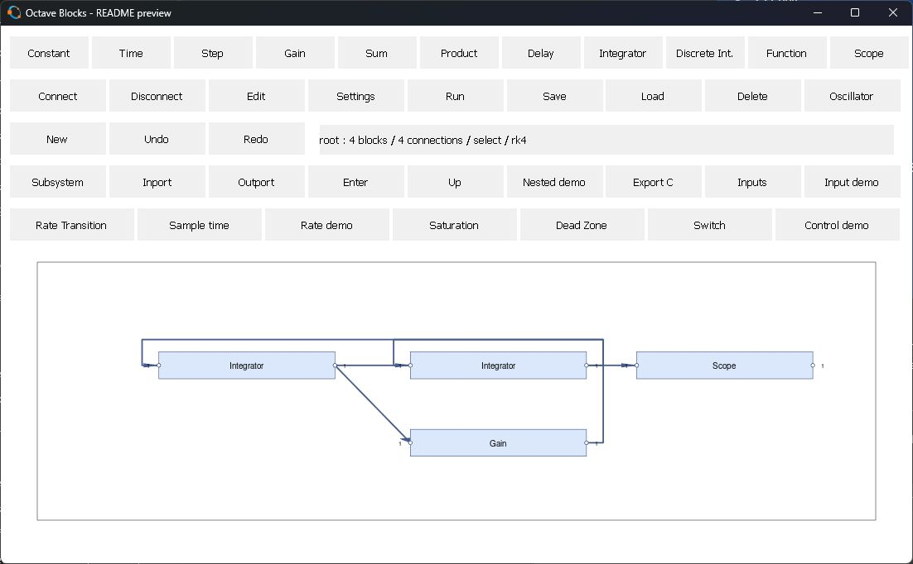

# Octave Blocks

**Build block diagrams. Run ordinary Octave functions. Export C99.**

[](https://github.com/ShannoonRuaaa/octave-blocks/releases)
[](https://octave.org/)
[](LICENSE)

Octave Blocks is a visual modeling and simulation project built around GNU
Octave. Connect continuous and discrete blocks, place your own `.m` functions
in the diagram, and inspect scalar, vector or matrix signals in a Scope.



[Download the preview](https://github.com/ShannoonRuaaa/octave-blocks/releases)
路 [User guide](doc/USER_GUIDE.md)
路 [Examples](#try-an-example)
路 [Roadmap](doc/COMPATIBILITY_GAPS.md)
路 [Report a problem](https://github.com/ShannoonRuaaa/octave-blocks/issues/new/choose)

## Start in a minute

Install **GNU Octave with Qt**. Verified on Octave 11.3.0 on Windows.
Download and extract a source release, or clone this repository.
Octave is installed separately; the download is not a standalone application.

From the extracted folder, launch the editor with PowerShell 7:

```powershell
./Launch-Blocks.ps1
```

Or open Octave and run:

```octave
cd ('/path/to/octave-blocks');
ob_setup ();
octave_blocks ();
```

Click a block to select it, **Connect** to wire two blocks, **Edit** to change
parameters, and **Run** to plot the result. **Oscillator** loads the feedback
example shown above. Save and load diagrams as Octave Blocks `.mat` models.
See the [user guide](doc/USER_GUIDE.md) for input data and subsystem editing.

## Install as an Octave package

For a packaged release, use Octave�s package manager:

```octave
pkg install '/path/to/octave-blocks-0.3.0.tar.gz';
pkg load octave-blocks;
octave_blocks();
```

The package archive is produced by `tools/Package-Release.ps1`; older preview
ZIPs use the source-checkout instructions above. Browse the installed API
with `pkg describe -verbose octave-blocks`. See [package layout](doc/PACKAGE_LAYOUT.md)
and the [documentation index](doc/README.md).

## What you can build

| Capability | Available on `main` |
| --- | --- |
| Visual modeling | Selection and dragging, numbered ports, nested diagrams, undo/redo and persistence |
| Simulation | RK4, Octave `ode45` and `ode15s`, explicit periods and offsets |
| Octave functions | Ordinary `.m` functions on the Octave path, including multiple outputs |
| Controls and hierarchy | Enabled/triggered subsystems, state/output policies, Saturation, Dead Zone, Switch and registered zero crossings |
| Linear systems | Continuous state-space and proper SISO transfer-function builders |
| C export | Static real-double C99 subset with RK4 and flat-model adaptive ode45, supported events and transactional APIs |
| Acceleration | Cached compiled MEX simulation for supported flat and conditional models; explicit fallback outside the subset |
| Additional blocks | PID and discrete-system builders, lookup tables, Transport Delay and Limited Integrator within the documented subsets |
| Programmatic modeling | Simulink-style construction, parameter and simulation commands with recorded reference comparisons |

This is an experimental independent project. Simulink `.slx`/`.mdl` file
interchange and full Simulink compatibility are unfinished. Arbitrary `.m`
functions run in Octave; export supports a documented subset of Function blocks.
See [supported exports](doc/CODEGEN.md) and [compatibility gaps](doc/COMPATIBILITY_GAPS.md).

The [advanced feature guide](doc/ADVANCED_EXTENSIONS.md), [command API](doc/SIMULINK_API.md)
and [validation record](doc/VALIDATION.md) describe the supported combinations.
The broader compatibility goal remains incomplete.

## Try an example

Run an oscillator without opening the editor:

```octave
model = ob_oscillator ();
result = ob_run (model, 0:0.02:12);
plot (result.t, ob_scope_data (result, 4));
xlabel ('Time (s)'); ylabel ('Position');
```


Explore `ob_subsystem_example()`, `ob_multirate_example()`,
`ob_continuous_control_example()` and `ob_linear_system_example()`.
Open any model with `octave_blocks(model)`.

Export the oscillator to C:

```octave
ob_codegen (model, 'oscillator.c', [0 12 0.02]);
```

Compile the optional CSV runner with a C99 compiler:

```sh
gcc -std=c99 -O2 -DOB_STANDALONE oscillator.c -lm -o oscillator
```

On Windows use `-o oscillator.exe`. A compiler is required for C export
verification, not for ordinary interpreted simulation.

## Documentation and verification

| Start here | Read more |
| --- | --- |
| [User guide](doc/USER_GUIDE.md) | Editor controls, model construction and examples |
| [Runtime](doc/RUNTIME.md) 路 [Events](doc/ZERO_CROSSINGS.md) | Resumable execution and event handling |
| [Subsystems](doc/CONDITIONAL.md) 路 [Multirate](doc/MULTIRATE.md) | State policies and scheduling |
| [C export](doc/CODEGEN.md) | Supported blocks, compilation and model APIs |
| [Validation](doc/VALIDATION.md) | Dated test evidence, reproduction and limits |
| [Contributing](CONTRIBUTING.md) 路 [Review guide](doc/REVIEW_GUIDE.md) | Development and code review |

The merged event-export milestone records 26 Octave suites, 25 BIST checks
and 242 strict C99 cases. These are recorded results for that milestone,
not a GitHub CI badge or a claim of complete compatibility. Run locally:

```powershell
./tests/Run-Tests.ps1
```

All suites, reference fixtures and runners live in [tests/](tests/README.md).
Generated C, executables and logs default to ignored `tests/.artifacts/`.
`./Launch-Blocks.ps1 -SelfTest` remains a shortcut to the same runner.
The editor checks require a desktop session and Qt. See
[VALIDATION.md](doc/VALIDATION.md) for the full environment.

## Releases and license

[Releases](https://github.com/ShannoonRuaaa/octave-blocks/releases) provide
versioned source ZIPs, SHA-256 checksums and feature notes. Preview releases
are intended for experimentation. See [CHANGELOG.md](CHANGELOG.md) and
[release instructions](doc/RELEASING.md).

The combined distribution is [GPL-3.0-or-later](COPYING), including adapted
Octave solver code. Original MIT copyright and permission notices are retained
in [LICENSES/MIT.txt](LICENSES/MIT.txt). Adaptive generated C includes GPL-derived
solver code; see [licensing and provenance](doc/LICENSING.md). GNU Octave is a separate dependency.
Octave Blocks is not affiliated with GNU Octave or MathWorks. MATLAB and
Simulink are trademarks of The MathWorks, Inc.
